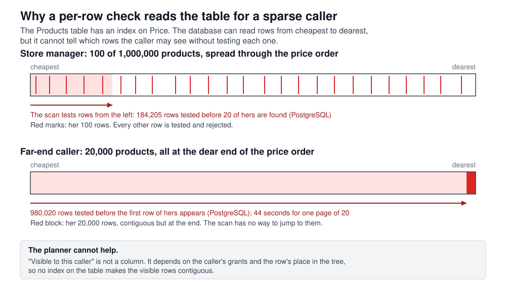
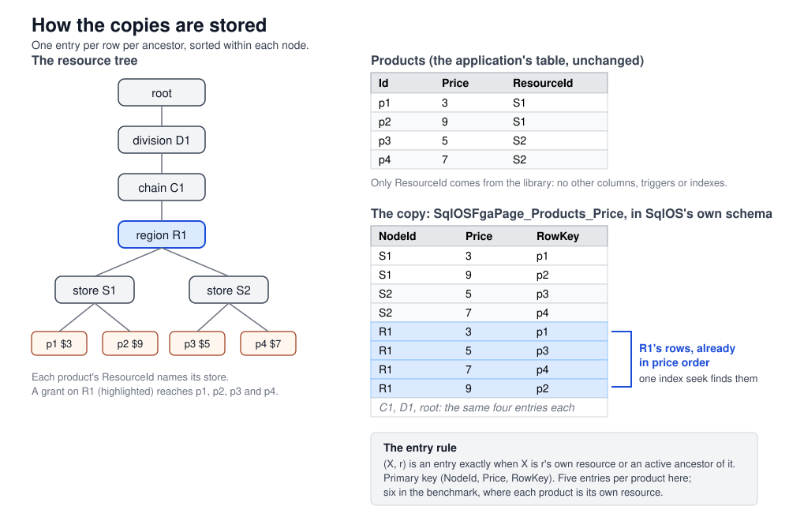
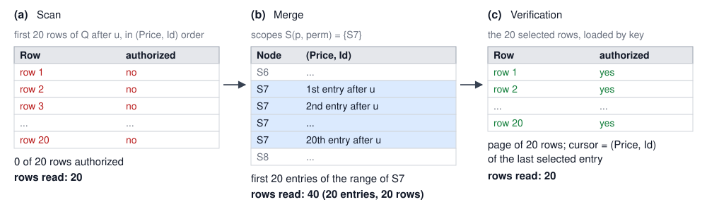
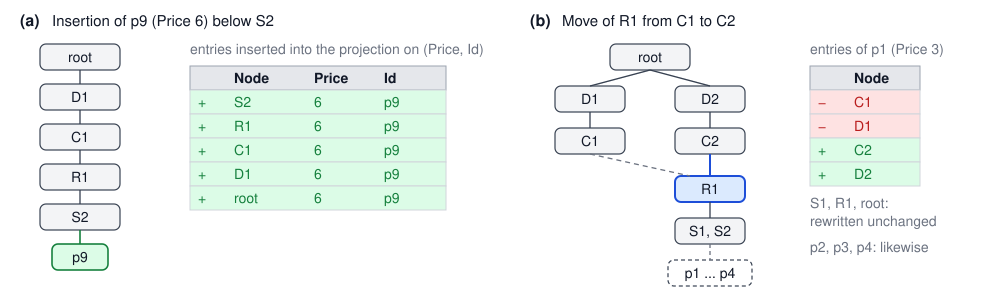

# Index What You Sort By: Bounded Authorized Pagination for Hierarchical Authorization

Ross Slaney

**Abstract.** Business software is commonly organized as a tree of resources, and access rights follow the tree: a user with a role at one node holds it at every node below. SHRBAC (Scoped Hierarchical Role-Based Access Control) formalizes this structure and enforces it with a single SQL predicate. Our earlier paper showed that a page of authorized rows costs about a page of work when the caller may see most of the table, and left the sparse case open. This paper measures the sparse case and resolves it. With one million products under ten thousand stores, a store manager who may see one hundred products requests the twenty cheapest; the per-row predicate reads 184,205 rows on PostgreSQL 16 and 368,410 rows on SQL Server 2022 to produce that page, and a caller whose rows lie at the end of the sort order reads nearly the whole table. We describe a mechanism that bounds the page for every caller. For each index on a protected table, the database maintains a copy of that index partitioned by node of the resource tree, in tables of its own. A page is the first rows under each of the caller's granted nodes, merged. Application tables are unchanged, grants do not leave the database, every returned row is verified by the original predicate, and the developer's only obligation is to index the columns the application sorts by. We state the design constraints, summarize seven implemented alternatives and the constraint each violated, prove the mechanism sound and complete, bound its cost, and evaluate it on both engines with one million rows across dense, sparse, scattered, far-end and many-grant callers. The store manager's page falls from 8,420 ms to 22.6 ms on PostgreSQL and from 179,558 ms to 89.0 ms on SQL Server, reading 80 and 100 rows respectively, while the administrator's page remains within a few milliseconds of its previous cost. Storage and write amplification grow with the number of indexes times the depth of the tree; both are measured.

---

## 1. Introduction

### 1.1 Hierarchical authority in business software

Organizations are structured as trees. A retailer is divided into divisions, chains, regions and stores; a law firm into clients, matters and documents; a software product into organizations, workspaces, projects and items. Authority follows the same structure: responsibility for a region includes every store in it and excludes the rest. The principle of least privilege [2] requires that a principal hold only the authority its task needs, and in an organization that authority is typically a subtree, a role and a period.

Commercial authorization systems have converged on this structure. WorkOS describes its fine-grained authorization product as "hierarchical, resource-scoped access control" in which resources are arranged in a hierarchy and permissions flow down it, with organizations, workspaces and projects as the documented example [21]. Auth0's fine-grained authorization service and the OpenFGA project it is built on model parent relationships between objects so that permission on a folder applies to its contents [22]. Google's Zanzibar, which authorizes Drive, YouTube and Cloud, stores folder containment as relationships so that permission on a folder reaches what the folder contains [1]. Dropbox defines a user's accessible files by the set of namespaces, shared folders and team folders, granted to her [23]. Figma's permission system resolves a file's access through its project, team and organization: "roles are hierarchical, so you might have access to the file through your role on a parent folder, team, or organization" [24]. Box, Google Drive and Notion inherit permissions down their folder or page trees; Notion's data model uses the parent attribute, an "upward pointer", as the basis of permission evaluation [25]. Azure role-based access control inherits assignments from management group to subscription to resource group to resource [16].

The same documentation identifies listing as the difficult operation. Zanzibar serves point checks at millions per second [1]. OpenFGA's ListObjects call stops by default after 1,000 results or 3 seconds, and its maintainers state that it cannot be paginated because "the graph evaluation is done concurrently (and thus is not ordered)" [26], [27]. AuthZed recommends LookupResources only "if the number of resources that a user has access to is small (e.g. less than 10,000 resources)" and offers a separate product, Materialize, that copies computed permissions "next to your application data" so that applications can "sort, filter, and paginate over many thousands of authorized objects natively in your own database" [28], [29]. Auth0 documents four strategies for "search with permissions" with a decision table, and notes that ListObjects performance "varies drastically depending on your authorization model complexity and tuple distribution" [22]. A sorted, filtered, paginated list of the objects a user may see is the operation these systems bound with result limits, deadlines, or a secondary copy of the data.

### 1.2 The first paper and the open case

Our earlier paper [30] formalized SHRBAC and showed that its structural constraints, a tree of resources, flat roles, non-recursive groups, and scoped time-bounded grants, allow the access decision to be expressed as one inline table-valued function, abbreviated TVF: a SQL function that the query planner expands into the calling query. An application lists authorized rows by appending the function as a `WHERE` condition to its own query, with its own filters, sort order and cursor. On SQL Server 2022 with 1.2 million resources, a page of twenty rows cost about 3.5 ms, independent of table size.

The complexity theorem of that paper bounds the cost per page by O(k · D) for a caller who may see most rows, where k is the page size and D the depth of the tree, and by O(k / σ · D) for a caller who may see a fraction σ of the rows. The evaluation covered "the evaluated dense-access workloads", and the limitations named the sparse case "an empirical failure mode to stress-test" [30, §8.4].

The sparse case is the common case in multi-tenant software. Of a million rows in a shared table, one customer's user may see a thousand, a store manager a hundred, a contractor three. This paper measures the first paper's method for such callers and presents a mechanism that bounds the page for every caller while preserving the first paper's guarantees.

### 1.3 The problem

Consider a million products under ten thousand stores, and a store manager who requests her products sorted by price, twenty at a time. The database has an index on price and reads products in price order without sorting. The index does not record which products are hers. That is determined by testing each product with the access function, which walks from the product through its store, region, chain and division looking for one of her grants. Her hundred products are distributed through the price order, so the twenty cheapest are found only after a large fraction of the table has been tested: 184,205 rows on PostgreSQL and 368,410 rows on SQL Server for the first page. A caller whose rows all lie at the expensive end of the order causes the database to test nearly the whole table before the first qualifying row.

No index on the application table resolves this. Visibility is not a column. It is a function of the caller's grants and of the row's position in the tree, and it differs between callers. The query planner does not know a caller's selectivity when it chooses a plan and cannot choose a plan per caller. Section 3.3 develops this point, which accounts for the failure of several designs in Section 5.

### 1.4 Contributions

1. **Measurement of the sparse case.** The first paper's per-row predicate is measured on SQL Server 2022 and PostgreSQL 16 with 1,000,000 rows as a caller's share of the table falls from 100% to 0.01%, and for a caller whose rows lie at the far end of the sort order (Section 3).
2. **Design constraints.** Nine requirements the solution had to satisfy, with the rationale for each, including requirements that are violated easily and silently: grants never leave the database, and no decision is made from an estimate (Section 4).
3. **Implemented alternatives.** Seven designs implemented and benchmarked between September 30 and October 14, 2026, closure tables, lineage columns, an adaptive tree walk, scope-index projections, a single predicate over a closure, declared page orders, and a scan-versus-list race, with the requirement each violated (Section 5).
4. **The mechanism.** A copy of every index on a protected table, partitioned by node of the resource tree; a page algorithm with two reads and a final check; same-transaction maintenance; and a single developer obligation, indexing the sorted columns, with no authorization-specific declaration (Section 6).
5. **Correctness and cost.** Soundness through the original predicate, completeness through an entry rule that mirrors the predicate's reachability, a per-page bound of O(P · D · M + k · P · log k) independent of the table size N and of the caller's selectivity σ, and storage and write bounds (Section 7).
6. **Evaluation.** Both engines, 1,000,000 rows, seven callers and a selectivity sweep, storage per table, write amplification, and the measured behaviour of the rejected race (Section 8).

**Notation.** N is the number of rows in the paged table; P the page size; D the maximum depth of the resource tree; L the number of levels on a row's resource path, counting the row's own resource and its ancestors, so L ≤ D + 1; M the number of effective principals of the caller (the user and her groups); σ the fraction of rows the caller may see; k the number of the caller's minimal granted nodes, defined in Section 6.5; and I the number of indexes on the paged table that define sort orders. Times are reported in milliseconds (ms) or seconds (s) and sizes in megabytes (MB). "Rows read" is the number of rows the engine's execution plan reports for its operators, as defined in Section 8.1.

### 1.5 Organization

Section 2 restates the SHRBAC model and reviews how other systems list under a hierarchy. Section 3 measures the sparse case and explains why the query planner cannot repair it. Section 4 states the design requirements. Section 5 describes the rejected designs. Section 6 presents the mechanism, Section 7 its correctness and cost, Section 8 the evaluation, Section 9 the discussion and limitations, and Section 10 concludes.

---

## 2. Background and Related Work

### 2.1 The SHRBAC model

The definitions below are taken from [30], which contains the full model, its properties and proofs.

Resources form a rooted tree of bounded depth D. Every row of a protected application table carries a `ResourceId` naming a node of the tree. Principals are users, groups, service accounts and agents. A user resolves to herself and her groups; groups do not nest, so resolve(p) is a fixed set of size M. Roles are flat lists of permissions. A grant is a tuple (principal, role, resource, from, to): it confers the role at the resource and, by inheritance, at every resource below it, during the time window. A node may be marked inactive, which removes access to it and to everything below it.

The access decision for principal p, permission perm, resource r and time t is:

```
allowed(p, perm, r, t) =
  ∃ p' ∈ resolve(p), ∃ r' ∈ ancestors(r), ∃ role:
    (p', role, r') is an active grant at t,
    perm ∈ perms(role),
    and every resource from r up to r' is active.
```

The first paper realized this decision as an inline table-valued function, `fn_IsResourceAccessible(resourceId, principalIds, permissionId)`, whose recursive common table expression walks from r to the root in at most D steps and joins the active grants at each step. It proved the function sound and complete (its Theorems 1 and 2) and showed that, when appended as `WHERE EXISTS (...)` to an application query with cursor pagination on an indexed sort key, a page costs O(k · D · M · G_max) for a dense caller, where G_max bounds the number of grants a principal holds on one resource. For a caller who may see a fraction σ of the rows the bound is O(k / σ · D · M · G_max); for a caller who may see nothing it is O(N · D · M · G_max).

The function is unchanged in this work. It remains the point check, the final check on every page, and the definition of correctness.

### 2.2 Listing under a hierarchy in deployed systems

Four patterns appear in the systems of Section 1.1.

**Check each candidate.** The application fetches a page of candidates from its database in the desired order and asks the authorization service about each, repeating until a page is full. Zanzibar describes search this way: "serving search results ... often require tens to hundreds of checks" per query [1]. Auth0's "search then check" and OpenFGA's batch-check pattern are the same procedure [22]; AuthZed's "CheckBulkPermissions with pagination" notes that "because we don't know how many results are going to be accessible beforehand, we need to iterate until" the page fills [28]. This is the per-row predicate of the first paper executed outside the database, with the same sparse-case cost: the number of candidates tested is k / σ.

**Expand the graph backwards.** The service starts from the user and walks the relationship graph to enumerate every object she can reach: OpenFGA's ListObjects, SpiceDB's LookupResources, Permify's Lookup Entity, WorkOS's resource discovery [22], [26], [28], [21]. The result is an unordered set of identifiers that the application intersects with its own query. The calls are capped because the walk has no order and its size is the number of objects the user may access, and the application must still sort and page the intersection. Auth0's documentation states that a partial list "is not enough, because you won't be able to sort using it" [22].

**Materialize permissions beside the data.** Zanzibar's Leopard index precomputes flattened group reachability [1]. AuthZed Materialize streams computed permission changes into the customer's database so that sorting and paging can be performed there [29]. Auth0 FGA documents a "Permissions Index" of precomputed direct relationships with the trade-off "do the expensive work when permissions change" [22]. Slack keeps "its own indexed copy of the message" for each organization in a shared channel [31]. These systems accept storage and write cost in exchange for a list the database can sort and page. The mechanism of Section 6 is also a materialization, with two differences: it is updated in the write's transaction rather than from a change stream, and it copies structure, which rows lie under which node in which order, rather than permission facts, so that grant changes do not invalidate it.

**Compile the policy into the query.** Oso's local authorization returns a SQL `WHERE` fragment [32], Cerbos's PlanResources returns a condition tree to be translated into a query [33], and Open Policy Agent's compile API returns a filter obtained by partial evaluation [34]. These push authorization into the database, as the first paper did, and inherit the cost model of a per-row predicate: the engine tests candidates in order until a page fills.

### 2.3 Row-level security and its cost model

Row-level security in PostgreSQL and SQL Server is Stonebraker and Wong's query modification [4] built into the engine. The documentation states the cost model. PostgreSQL evaluates a policy expression "for each row prior to any conditions or functions coming from the user's query" [35]. Supabase's performance guide repeats it, "Postgres evaluates a policy expression against each candidate row, so the cost scales with the rows a query scans", and its advice begins with indexing the columns the policies filter on, wrapping function calls so that they run once per query, and adding explicit filters to queries rather than relying on the policy alone [36]. Its worked example, a membership check over a million rows, improves from over 180 seconds to 2–3 ms once the membership set is materialized into an array and the column is indexed [36]. SQL Server's guidance for its row-level security is to "avoid recursion in predicate functions wherever possible" [37]; practitioners recommend flattening hierarchies at load time rather than traversing them per query: "every join added to a predicate degrades performance at scale"; "denormalize security lookup data" [38].

A per-row predicate costs the number of rows tested, which is the number of candidates examined before the page fills. Indexing the predicate's inputs does not change that count. Bounding the page requires the authorized rows to be contiguous in the order the query requests.

### 2.4 Hierarchy encodings that make a subtree contiguous

Several storage encodings make a subtree contiguous in one order. SQL Server's `hierarchyid` type sorts in depth-first order, so that "all nodes in the subtree of a node are colocated" in a depth-first index [39]. Google Spanner's interleaved tables store child rows physically under their parent's key, up to seven levels deep [40]. Closure tables store one row per (ancestor, descendant) pair, so that "querying it is extremely fast and simple", at the cost of moves, which rewrite the pairs of the moved subtree [41]. Materialized paths and nested intervals are the other classical encodings [42].

Each of these provides one order, the tree's own. A product listing sorted by price requires the subtree in price order; sorted by name, in name order. The structure of Section 6 is a closure table extended by the sort key, one row per (ancestor, sort value, row), with a separate copy per index. It trades storage, one copy per level per index, for contiguity of every subtree in every indexed order. Taking the first P rows from the union of k sorted ranges is the multi-list top-P problem [43]; the database performs it with a correlated subquery per node and an `ORDER BY ... TOP (P)` over the union.

### 2.5 Position of this work

The mechanism of Section 6 is a materialization of structure rather than of permission, maintained in the write's transaction and verified on every page by the original predicate; in database terms it is a closure table per sort order. Its distinguishing property is the combination of a bounded page for every caller under a hierarchical model with no additions to application tables, grants that remain in the database, one implementation on two engines, and no declaration beyond the indexes the application defines for its own queries.

---

## 3. The Sparse Access Problem

### 3.1 Workload

All measurements in this paper use one retail workload, built with SqlOS [44], the open-source implementation of SHRBAC, on both database engines. The resource tree is root → 5 divisions → 10 chains per division (50) → 10 regions per chain (500) → 20 stores per region (10,000) → 100 products per store (1,000,000). Every product has its own resource node, so a product's path has six levels: itself, its store, region, chain, division and the root. Prices are spread uniformly through the products, except that one chain's 20,000 products carry the highest prices; that chain belongs to the "far end" caller. The `Products` table has an index on `(Price, Id)`, as any application sorting by price would.

Seven callers represent the range of users. Each holds grants exactly on the nodes its name states, with a role carrying the `product.view` permission:

| Caller | Grants | Products visible | Share of the table |
| --- | --- | ---: | ---: |
| Administrator | one, on the root | 1,000,000 | 100% |
| Region manager | one, on a region | 2,000 | 0.2% |
| Store manager | one, on a store | 100 | 0.01% |
| 100 stores | 100, one per store | 10,000 | 1% |
| 10,000 single products | 10,000, one per product | 10,000 | 1% |
| Far end | one, on the high-price chain | 20,000 | 2%, all at the end of the price order |
| Scoped store manager | one, on a store; the query also filters by `StoreId` | 100 | 0.01%, but the query itself selects only her store |

The query is "products sorted by price, twenty at a time", with a cursor for the next page. The scoped caller's query adds `WHERE StoreId = @mine`, as a screen that already knows its store would.

### 3.2 Cost of the per-row predicate

Table 1 reports the first paper's method on this workload: the application query with `WHERE EXISTS (SELECT 1 FROM fn_IsResourceAccessible(...))` appended, `ORDER BY Price, Id`, and `TOP (20)`. The caller's principals are resolved once before timing starts, as in the first paper's benchmark. "Rows read" is the count of rows the engine's execution plan reports for the operators over `Products`, taken from `SET STATISTICS XML` on SQL Server and `EXPLAIN (ANALYZE)` on PostgreSQL, including on PostgreSQL the rows a filter removed. The machine and the measurement protocol are described in Section 8.1.

**Table 1. The first paper's per-row predicate at 1,000,000 products, page of 20, sorted by price.**

| Caller | Visible | SQL Server 2022: time (ms) | rows read | PostgreSQL 16: time (ms) | rows read |
| --- | ---: | ---: | ---: | ---: | ---: |
| Administrator | 1,000,000 | 23.7 | 40 | 5.6 | 20 |
| Region manager | 2,000 | 9,032 | 18,612 | 416.8 | 9,306 |
| Store manager | 100 | 179,558 | 368,410 | 8,420 | 184,205 |
| 100 stores | 10,000 | 2,227 | 4,466 | 107.6 | 2,233 |
| 10,000 single products | 10,000 | 1,420 | 2,904 | 70.8 | 1,452 |
| Far end | 20,000 | 942,593 | 1,960,040 | 44,208 | 980,020 |
| Scoped store manager | 100 | 18.4 | 40 | 5.4 | 20 |

Source: the SqlOS page-order benchmark, pull request #516, October 2026 [45]. SQL Server reads each row twice in these plans, once in the price index and once by key lookup for `ResourceId`, so its row counts are about twice PostgreSQL's.

The administrator and the scoped store manager read 20 rows on PostgreSQL and complete in a few milliseconds; their rows are contiguous in the order the query requests, either because every row is theirs or because the query's filter already selects their store. The unscoped store manager reads 184,205 rows in 8,420 ms on PostgreSQL and 368,410 rows in 179,558 ms on SQL Server for a page of twenty rows. The far-end caller reads 980,020 rows in 44,208 ms on PostgreSQL and 1,960,040 rows in 942,593 ms on SQL Server. The region manager, who may see 0.2% of the table, is about 75 times slower than the administrator on PostgreSQL. Figure 1 illustrates the two sparse shapes.



The behaviour was first observed in September 2026 in the library's continuous-integration benchmark, where a store manager's unscoped page took 33–43 seconds on PostgreSQL and 160 seconds on SQL Server at this scale [46]. It is the O(k / σ · D) term of the first paper's Theorem 3.

### 3.3 Why the planner cannot repair it

A better index or better statistics do not allow the query planner to locate the store manager's rows directly. Two of the designs in Section 5 attempted this.

A query plan is chosen before execution from statistics about columns. The quantity that determines the correct plan is σ, the fraction of rows the caller may see. For the administrator the correct plan walks the price index and tests rows: she sees everything, so the first twenty rows are hers. For the store manager the correct plan finds her hundred rows first and sorts them. But σ is not a property of any column. It is a property of the caller's grants, which the planner does not consult. When the grants were made visible to the planner as a parameter, the per-column statistics could not distinguish a root grant from a store grant: the column for the top level holds one distinct value, the root, so a predicate of the form "ancestor at level ℓ equals this node" was estimated as matching every row whatever node was supplied, and the cheap plan for a sparse caller was never chosen [47]. The planner chose one plan for all callers and changed it as the table grew: at 100,000 rows PostgreSQL scanned the tree for every caller; at 1,000,000 it probed row by row for every caller, so that the store manager read 400,000 rows [47].

What a caller may see must therefore be stored before planning rather than estimated during it. Storing, independently of any caller, which rows lie under which node in which order reduces the caller-dependent part of the query to a set of index seeks whose number is the number of the caller's nodes rather than a function of her selectivity.

---

## 4. Design Requirements

The following requirements were fixed before implementation. Designs in Section 5 were rejected for violating them regardless of their measured speed.

**R1. The resource graph is authoritative.** The resource, grant, role and principal tables are the only authority on access. Any other structure is a derived index, rebuildable from those tables and the application rows with one command, and every row a list returns is verified against the authoritative tables before it is returned. *Rationale:* a derived index may be stale after a bulk load or a defect; a stale index may hide a row but must not expose one.

**R2. Application tables are unchanged.** The library adds one column to a protected table, `ResourceId`, and an index on it; no other columns, triggers, computed columns or library-owned indexes. *Rationale:* application tables belong to the application and its schema tools.

**R3. Grants do not leave the database.** A statement that lists or checks carries two caller-dependent parameters: the caller's principal identifiers and the permission identifier. It does not carry a list of the caller's grants, granted nodes, roots or visible keys, and the application does not read such a list into memory. *Rationale:* the number of grants is unbounded, a parameter list is a scan in another form, and the database can compute the set within the statement.

**R4. One implementation on both engines.** The same tables, statement shapes and tests on SQL Server and PostgreSQL. Dialects differ in syntax only. *Rationale:* two implementations are two sets of defects, and a design that only one planner executes well cannot be relied on by users of the other engine.

**R5. One procedure, no estimates.** One list call, with no modes, options, thresholds, sampled counts, or fallbacks selected at run time, and no reliance on the query planner selecting a suitable plan per caller. *Rationale:* Section 3.3. A decision made from an estimate is correct on average and incorrect for the callers with the least access; performance that depends on the planner's choice cannot be guaranteed.

**R6. The application's query remains the application's.** Filters, sort order, includes and cursor pagination are expressed in the application's own query language (LINQ over Entity Framework Core in the implementation). Any sort a screen offers must be supported, scoped or unscoped. *Rationale:* composability is the property the first paper established.

**R7. A page is not linear in the table.** The budget accepted during design was about √(N · P · D) index operations in the worst case; the design achieves about P entries per granted node. *Rationale:* a cost proportional to table size grows with the deployment.

**R8. Consistency in the write's transaction.** Whatever the library stores is updated in the same transaction as the application's write, so that a committed row is visible in lists immediately and a rolled-back write leaves nothing behind. *Rationale:* eventually consistent authorization indexes are the operational burden the systems of Section 2.2 place on their customers.

**R9. The developer's obligation is one sentence.** Whatever the developer must do to obtain bounded pages must be expressible in one sentence, preferably one they already follow. *Rationale:* a mechanism that is bounded only when configured correctly fails silently when a configuration is omitted, and code generated by autonomous agents cannot be relied on to include library-specific configuration.

---

## 5. Implemented Alternatives

Seven designs were implemented, tested on both engines and benchmarked at 1,000,000 rows between September 30 and October 15, 2026 before the design of Section 6. All returned correct pages. Table 2 lists them with the requirement each violated.

**Table 2. Designs implemented before the final one.**

| Design (pull request, dates) | What it stored | Store manager's page on PostgreSQL | Requirement violated |
| --- | --- | --- | --- |
| Closure table and root enumeration (#465, Sept 30–Oct 1) | an (ancestor, descendant) closure of the tree; the caller's granted roots computed once per query | 25 s → 15 s through the composable filter; fast only through a separate fixed-order list call | R3 (roots read into memory), R5 (a second list call) |
| Lineage columns and scope columns (#467, Oct 1–8) | ancestor identifiers per level on the resource table; a scope column with per-level indexes on every protected table, kept by triggers | 1.6 ms | R2 (columns, triggers and indexes on application tables), R3 (roots passed as parameters) |
| Adaptive tree walk (#503, Oct 6–8; shipped as 8.0.0, reverted Oct 11) | per-(principal, node) grant counts, a direct-grant index, a replaced query compiler | 1.5–11 ms for one-grant callers; about 80 ms for a caller with 100 scattered stores | R2 (triggers and eleven or more indexes per protected table), R9 (an illegible footprint) |
| Owned scope-index projections (#508, Oct 9) | the scope columns moved into one projection table per protected table, kept by triggers | as above | R2 (triggers), R5 (a query rewrite) |
| One predicate over a closure, plan chosen by the planner (#509/#510, Oct 9–11; shipped as 9.0.0, reverted the same day) | the closure with eleven per-level indexes; one `fn_Visible` predicate | 2.9–4.8 s over 400,000 rows at 1,000,000 products | R5 (the plan depended on the planner's estimate of the caller) |
| Capped visible count choosing between two filters (same pull request) | as above, plus a function counting the caller's rows up to a cap | 4 rows at 100,000 products; seeks at 1,000,000 | R5 (a threshold, and `OPTION (RECOMPILE)` on SQL Server) |
| Declared page orders (#515/#516, Oct 12–13; shipped as 10.0.0) | a copy of each *declared* sort order under every node | 22.6 ms, 80 rows | R9 (an undeclared sort scanned, with one logged warning) |
| Key-only node index with a scan-versus-list race (#521/#522, Oct 14) | which rows lie under which node, for every entity; for an undeclared sort, a race with doubling budgets between scanning in order and listing the caller's rows | 59.3 ms, 742 rows; the far-end caller 1,054,147 rows | R5 (a race is an estimate; PostgreSQL replaced 20,000 key lookups by a full scan), R7 |

Every design that let the caller's grants or roots out of the database (#465, #467) performed well for a caller with one grant and degraded to a parameter list for a caller with many; a sharing feature that grants access per file produces callers with thousands of grants.

Every design that relied on the planner to choose per caller (#509, #510, #522) performed well at one scale and failed at another. The single-predicate closure design had clean tables, one predicate and nothing new to maintain. Its premise, that per-level indexes on the closure would lead the planner to probe for sparse callers and scan for dense ones, did not hold: the planner chose one plan for all callers from statistics that do not see the caller, and changed that plan as the table grew (Section 3.3). The race of #522 had the same weakness in a different form: two statements with growing budgets, with the planner free to replace twenty thousand key lookups by a scan of a million rows when its cost model found them comparable, which it did (Section 8.6).

The designs that placed structure on application tables (#467, #503, #508) were the fastest, at 1–2 ms, and the most expensive to operate: triggers that guard against re-firing, a lineage lock against concurrent moves committing a cycle, eleven or more indexes per protected table, and a replaced query compiler.

The declared page orders of #516 are the design of Section 6 except that each sort had to be declared by name; an undeclared sort returned correct pages at linear cost with one logged warning. The release that followed, SqlOS 11.0.0, removed the declaration.

---

## 6. The Mechanism

### 6.1 Overview

For each sort order a protected table can be paged by, a copy of that order is kept under every node of the resource tree, so that a page for any caller is the first rows under each of the caller's nodes, merged.

Figure 2 shows a small tree in which each product's `ResourceId` names its store. Product p4, priced 7, lies under store S2, which lies under region R1, chain C1 and division D1, so p4 appears in the price copy five times: once under S2, once under R1, and once each under C1, D1 and the root. Within each node the entries are in price order. A region manager with a grant on R1 reads the range of the copy belonging to R1, which holds exactly the four products in her region, cheapest first. A manager of two regions reads two ranges and merges them. An administrator does not use the copy; the query's own index serves her.



### 6.2 The entry rule

Each copy is a table in the library's own schema with three parts: the node, the sort columns, and the row's primary key. Its primary key is `(NodeId, sort columns…, RowKey)`, the index a page reads; a second index on `(RowKey)` serves maintenance.

**Definition 1 (Entry rule).** An entry (X, r) exists in the copy of an order for table T if and only if X is the resource of row r or an ancestor of it, every resource on the path from r's resource up to and including X is active, and that path is within the configured maximum depth and contains no cycle.

The rule mirrors the access function: `fn_IsResourceAccessible` grants access to r through a grant on X exactly when X lies on r's active ancestor path within the depth bound. The nodes under which r has entries are therefore the nodes on which a grant could reach r. A row whose own resource is inactive, or whose `ResourceId` names no resource, has no entries, and no grant reaches it.

In the retail workload every product has six entries per copy: 6,000,000 entries for 1,000,000 products.

### 6.3 Which orders are copied

The copies are determined by the application's indexes. For every protected table, an entity implementing the library's `IHasResourceId` interface:

1. The primary key defines an order, so a list sorted by key pages.
2. Every index on the table defines an order over the index's columns, with the primary key appended as the final tiebreaker. An index that already ends with the key, such as `(Price, Id)`, defines the same order as `(Price)`. Unique, filtered and descending indexes, and included columns, are treated alike: one copy serves ascending and descending pages.
3. Two kinds of index are lookups rather than sorts and are not copied: an index that contains `ResourceId`, and an index whose columns are exactly those of a foreign key, which the object-relational mapper adds for every relationship.
4. No automatic order causes a failure. A table that cannot have copies, for example one with a composite key or mapped to a view, and an index with a column that cannot be an order column, for example a nullable column, are skipped and logged once at startup with the reason.

Matching at query time is exact: the query's sort columns, with the key appended, must equal a copy's columns name by name, in sequence; direction is free. A sort by name then city requires an index on `(Name, City)`, as in any database.

No declaration to the library is required. The application indexes the columns it sorts by, as it would for performance alone. A sort with no index is served by the first paper's method for every caller, as an unindexed sort scans in any database, and the library logs a warning naming the index to add. This replaces the per-sort declaration of #516; there is no authorization-specific configuration to omit.

### 6.4 Storage

A copy of order o for a table with N rows holds Σ_r L(r) entries, where L(r) is the number of levels on r's active path, at most D + 1. With I sort indexes and the key, the total is at most N · (D + 1) · (I + 1) entries. Each entry carries the node identifier, the sort values and the row key, with the source columns' types, lengths and collations copied so that ordering in the copy agrees with ordering in the table. Section 8.7 reports 550 MB to 866 MB per copy at 1,000,000 products with six levels on PostgreSQL.

### 6.5 The caller's nodes

A page requires the set of nodes on which the caller holds grants, reduced to those that contribute rows. A grant on a store inside a granted region adds nothing, because every row under the store is already under the region.

**Definition 2 (Minimal granted nodes).** For a caller p and permission perm, the minimal granted nodes K(p, perm) are the resources X such that some p' ∈ resolve(p) holds an active grant at X whose role carries perm, X is active, and no proper active ancestor of X satisfies the same condition.

The library computes K inside the database with a function, `fn_PageNodes(principalIds, permissionId)`, that takes the two parameters permitted by R3. It joins grants, roles, permissions and principals using the same text as the access function, so that the two cannot diverge, and removes every granted node that has a qualifying node among its ancestors. The subtrees under distinct minimal nodes are disjoint, so the page merges ranges without deduplication. k = |K|.

### 6.6 The page algorithm

The list call is one method on the application's query: `query.OrderBy(...).ToPageAsync(principalId, permission, pageSize, cursor)`. The query may carry filters and includes; its sort order and the cursor are read from it. The algorithm runs a scan step, then if required a merge step, then a load with the final check.

```
ALGORITHM AuthorizedPage(query, p, perm, P, cursor):
  principals ← resolve(p); permId ← lookup(perm)      // two small statements
  b ← P
  LOOP:
    // Scan step: the application's query, in its order, from the cursor,
    // each row tagged with the access function's verdict.
    rows ← first b rows of query after cursor, with visible(row) := EXISTS fn_IsResourceAccessible(row.ResourceId, principals, permId)
    if at least P of rows are visible: keys ← first P visible; EXIT LOOP
    if fewer than b rows came back: keys ← all visible rows; last page; EXIT LOOP
    // Merge step: only when an index covers the order.
    if a copy exists for the query's order:
      for each node X in fn_PageNodes(principals, permId):
        range_X ← first b entries of the copy under X, after the cursor, whose row passes the query's filters
      merged ← the first P of (⋃ range_X) in order
      if |merged| = P: keys ← merged; EXIT LOOP
      else: keys ← merged; last page; EXIT LOOP     // every node ran out
    b ← 4 · b                                         // only an order with no index gets here
  page ← load keys through query (includes, tracking) WHERE visible(row)   // the final check
  cursor' ← order values of the last row of page
  RETURN page, cursor'
```

**The scan step** is the first paper's method with a budget. It reads the next b rows of the query in the query's order and tags each with the access function's verdict in the same statement. For an administrator, or for a query already scoped to the caller's own store, the first twenty rows are visible and the page completes in one statement. For a caller who may see little, the scan returns twenty rows of which few or none are visible, at the cost of twenty access checks.

**The merge step** runs only when the scan did not fill the page and an index covers the order. Under each minimal node it reads the next b entries after the cursor, in order, keeping entries whose row passes the application's filters (an `EXISTS` on the row against the query without its ordering), and merges the ranges to the first P. In SQL this is one statement: the node function cross-applied to a per-node `TOP (b)` range (`CROSS APPLY` on SQL Server, `JOIN LATERAL` on PostgreSQL), then `ORDER BY` the sort columns and `TOP (P)`. Because b is never below P, the merge step settles the page in the round it runs: either P entries are returned, or fewer, in which case every node is exhausted and these are the last rows.

**The budget b** starts at P and grows fourfold only for an order no index covers. That path is the first paper's method and the only path on which the page's cost depends on σ. An indexed order does not take it.

**The load and final check** fetch the page's rows through the application's own query, so that includes and change tracking behave as configured, and apply the access function once more to each row. A copy entry can therefore cause a row to be absent from a page, if the copy is stale, but cannot cause a row to be returned that the access function rejects. This realizes requirement R1.

**The cursor** is the last returned row's sort values. A row dropped by the final check does not stall the list, because the cursor is taken from the rows returned. Consecutive pages may be served by different steps with the same cursor.

Figure 3 traces one page for the store manager. The scan step reads twenty rows and finds none of hers. The merge step obtains her minimal nodes from the database, her one store, seeks that node's range in the copy and takes twenty entries. The load fetches those rows through her query and checks each once more.



### 6.7 Maintenance

The copies are updated by the library's database context in the same transaction as the application's save (R8). Before a save, the context checks whether the tracked changes include a resource or a row of a protected table. If not, the save proceeds unchanged. Otherwise, inside the caller's transaction or one the context opens, it saves, then collects what the save wrote (added and deleted rows; rows whose `ResourceId` or a sort column changed; resources added, deleted, moved, or whose activity changed) and issues one command that, per copy, deletes the entries of the changed rows by key, deletes and reinserts the entries of every row under a moved or deactivated resource and its descendants (a recursive walk bounded by the depth), and inserts the entries of the changed rows using the access function's ancestor rule. Each row ends with exactly one correct set of entries, or the save rolls back.

Figure 4 shows the two kinds of write. An insert writes one entry per ancestor into each copy. A move of a region deletes and rewrites the entries of every row in its subtree along the new path. Both occur inside the application's transaction.



Two engine-specific adjustments were required at one million rows. On PostgreSQL, the estimated cost of the recursive walk exceeded the just-in-time compilation threshold, so every save that added a resource compiled its statements, at about 165 ms per single insert; the command now disables JIT for its own statements and restores the caller's setting. On both engines, walking the subtree from every changed resource, including added resources that have no descendants, caused the planner to hash the whole copy for a save that added a thousand rows; walking only moved or deactivated resources reduced that save's statements from 2.4–3.1 s each to 66–111 ms.

Writes that bypass the object-relational mapper (bulk loads, raw SQL, bulk updates) do not update the copies. For these the library provides one command, `RebuildPageOrdersAsync`, which deletes and rewrites every copy from the application tables and the resource graph (R1). The same rebuild runs at startup for a copy whose table exists and is empty while its table has rows, which is the state after an index is added. Until a copy's table exists, for example before a migration is applied, pages for that order take the scan path and the condition is logged.

### 6.8 Developer interface

```csharp
// The model: an entity whose rows carry a ResourceId.
modelBuilder.Entity<Product>(entity =>
{
    entity.HasKey(p => p.Id);
    entity.Property(p => p.ResourceId).HasMaxLength(100).IsRequired();
    entity.HasIndex(p => p.ResourceId);
    entity.HasIndex(p => new { p.Price, p.Id });               // the sort the screen offers
    entity.HasIndex(p => new { p.Status, p.CreatedAt, p.Id }); // another sort
});

// A list endpoint.
var page = await db.Products
    .Where(p => p.Name.Contains(term))
    .OrderBy(p => p.Price)
    .ToPageAsync(principalId, "product.view", pageSize: 20, cursor);
return Results.Ok(new { page.Data, page.NextCursor });
```

Adding the index produces one copy table through the ordinary migration; the next start fills it. Nothing else is declared, and the endpoint refers to authorization only through the principal and the permission.

---

## 7. Correctness and Cost

### 7.1 Soundness

**Theorem 1 (Soundness).** Every row returned by AuthorizedPage satisfies allowed(p, perm, resource(row), now).

*Proof.* The only statement that produces returned rows is the load, which applies `EXISTS fn_IsResourceAccessible(row.ResourceId, principals, permId)` to every candidate key at execution time. By Theorem 1 of the first paper, a non-empty result of that function implies allowed. Keys reach the load from the scan step or from the merge step; neither path bypasses the load's predicate, so no entry of any copy, current or stale, can cause a row to be returned without passing the access function. □

Soundness does not depend on the copies. They determine which rows are found, not which rows are allowed.

### 7.2 Completeness

**Lemma 1 (Entries mirror reachability).** If the copies satisfy Definition 1, then for every row r and node X, (X, r) is an entry if and only if a grant at X could reach r under the access function.

*Proof.* Both conditions state that X lies on r's active ancestor path within the depth bound. The rebuild writes exactly that set, using the same ancestor rule as the access function; the maintenance of Section 6.7 preserves it for every write it observes, which the implementation's tests verify by comparing the entries after each kind of write with a fresh rebuild. □

**Lemma 2 (Minimal nodes cover the caller's rows disjointly).** For every row r, allowed(p, perm, resource(r), now) holds if and only if some X ∈ K(p, perm) lies on r's active ancestor path, and at most one X ∈ K does.

*Proof.* If allowed holds through a grant at some node Y on r's active path, then either Y is minimal or some proper active ancestor of Y holds a qualifying grant; following ancestors upward along r's path, which is finite, reaches a minimal node on that path. Conversely, a minimal node on the path holds a qualifying grant, so allowed holds. If two minimal nodes lay on the same path, one would be an ancestor of the other, contradicting minimality. □

**Theorem 2 (Completeness).** If the copies satisfy Definition 1, AuthorizedPage returns the first P rows, in the query's order after the cursor, that pass the query's filters and satisfy allowed, and returns fewer than P only when no further such rows exist.

*Proof.* If the scan step fills the page, the P rows it returns are the first P visible rows of the query after the cursor, since it reads the query in order and tags every row. Otherwise the merge step runs. By Lemmas 1 and 2, the set of allowed rows after the cursor that pass the filters is the disjoint union over X ∈ K of the rows with an entry under X, after the cursor, passing the filters. Each per-node range reads those rows in the query's order, so the first P rows of the union are among the first P of their own ranges; reading b ≥ P from each range and taking the first P of the union yields exactly them. If the union holds fewer than P rows, every range is exhausted and all remaining rows are returned. The load's final check removes none of them, because by Lemma 1 each has a qualifying grant on its path. □

Completeness, unlike soundness, depends on the copies being current. After a write that bypassed maintenance, a row may be absent from pages until the next rebuild (Section 6.7).

### 7.3 Page cost

**Theorem 3 (Per-page cost).** For an order with a copy, a page of size P for a caller with k minimal nodes and M effective principals costs O(P · D · M) for the scan step, O(k · P · log k) for the merge step, and O(P · D · M) for the load; the total is O(P · D · M + k · P · log k), independent of N and of σ.

*Proof.* The scan step reads at most P rows from the query's index after the cursor and evaluates the access function on each: P · O(D · M · G_max) with G_max bounded, as in the first paper's Theorem 3. The merge step performs one index seek per node into the copy's primary key, reads at most b = P entries per node, and merges at most k · P entries by a sort or a heap. The load reads P rows by key and evaluates the access function P times. No term contains N or σ. □

Two refinements apply. When the caller has fewer nodes than rows per node, which holds for every scoped grant on a container, the merge step reads about P entries from a small number of nodes: the 80 to 100 rows per page measured in Section 8. With an application filter that only a fraction f of a node's rows pass, the per-node range reads entries until P pass, so the cost per node becomes O(P / f), bounded by the rows under the node; the cost is bounded by what the caller may see, not by the table.

The scan step runs first because it costs at most P access checks, serves dense callers in one statement without reading a copy, and reads at most P rows. Running the merge step first would charge every dense caller a node lookup and a merge for pages the query's index answers.

### 7.4 Storage and write cost

**Proposition 1.** With N rows, at most D + 1 levels per row and I sort indexes, the copies hold at most N · (D + 1) · (I + 1) entries. Inserting a row, or changing its `ResourceId` or a sort column, writes at most (D + 1) · (I + 1) entries. Moving, deactivating or reactivating a resource rewrites the entries of every row in its subtree: S · (D + 1) · (I + 1) for a subtree of S rows. A full rebuild writes every entry once.

The rebuild is the only operation linear in N. Section 8.7 reports the measured constants: a single insert rises from 1.4 ms to 5.7 ms with three copies; a move of a region holding 2,000 products from 5.2 ms to 501.0 ms.

### 7.5 Costs not bounded by a page

The bound of Theorem 3 contains k. A caller with 10,000 individual grants performs 10,000 seeks and reads about 2P entries from each: 20,040 rows per page in Section 8. This is the cost of a sharing pattern that grants access per file, and it remains independent of N. An application filter that few of the caller's rows pass reads the caller's entries until a page passes, bounded by the caller's rows. An order with no index is served by the scan path alone, at the first paper's cost, for every caller.

---

## 8. Empirical Evaluation

### 8.1 Setup and protocol

**Machine.** All measurements in this section were taken on one Apple Silicon laptop with Docker Desktop. PostgreSQL 16 runs natively with default settings, including just-in-time compilation. SQL Server 2022 is the x64 image running under CPU emulation, which inflates every statement by tens of milliseconds; its row counts are exact, its times are not representative of native hardware, and conclusions are drawn from ratios within an engine. The first paper's 3.47 ms dense page was measured on a different machine and is not comparable to any number here.

**Data and callers.** The retail workload of Section 3.1: 1,000,000 products under 10,000 stores, 500 regions, 50 chains and 5 divisions, with every product its own resource; the seven callers of Table 1; page size 20; the query sorted by price. The `Products` table has indexes on `(Price, Id)` and `(StoreId, Price, Id)` and a unique index on `ResourceId`. In the final implementation the price index and the key give copies `SqlOSFgaPage_Products_Price` and `SqlOSFgaPage_Products_Id`; the `(StoreId, Price, Id)` index gives a third copy that no scenario pages by.

**Two methods.** Method A is the first paper's: the application query with the access function appended as a `WHERE EXISTS`, `ORDER BY Price, Id`, `TOP (20)`, with the caller's principals resolved before timing starts. Method B is the page call of Section 6.6; its time includes resolving the caller's principals and the permission, two further statements, so a dense page under method B runs four statements where method A ran one.

**Measurement.** Each scenario is run after a warm-up and timed for up to 15 runs within a 60-second budget; the median is reported. A run longer than a minute is measured once. "Rows read" is the sum, over every statement a page executes, of the rows the engine's actual execution plan reports its operators over `Products` and the copy tables produced, from `SET STATISTICS XML` on SQL Server and `EXPLAIN (ANALYZE, FORMAT JSON)` on PostgreSQL; on PostgreSQL rows removed by a filter are included. Row counts are deterministic; times on a shared laptop vary between runs and should be read as ratios to one significant figure.

**Provenance.** Tables 3 and 4 are from the benchmark of pull request #516 (October 13, 2026, released as SqlOS 10.0.0) [45], which measured method B with the price order declared explicitly. The final implementation (pull request #524, released as SqlOS 11.0.0 on October 15, 2026) derives the same copy from the price index and runs identical statements; its re-measurement on PostgreSQL reproduced every row count in Table 4 (Section 8.3). Table 5 is from the benchmark of pull request #522 [48], run on a build whose scan and merge statements are the same as the final ones, with the same data. Tables 6, 7 and 8 are from pull requests #522 and #524 [48], [49].

### 8.2 Results on SQL Server 2022

**Table 3. SQL Server 2022, 1,000,000 products, page of 20 sorted by price. Method A is the first paper's per-row predicate; method B is the page call of this paper.**

| Caller | Visible | A: time (ms) | A: rows read | B: time (ms) | B: statements | B: rows read |
| --- | ---: | ---: | ---: | ---: | ---: | ---: |
| Administrator | 1,000,000 | 23.7 | 40 | 52.3 | 4 | 60 |
| Region manager | 2,000 | 9,032 | 18,612 | 88.2 | 5 | 100 |
| Store manager | 100 | 179,558 | 368,410 | 89.0 | 5 | 100 |
| 100 stores | 10,000 | 2,227 | 4,466 | 93.7 | 5 | 4,060 |
| 10,000 single products | 10,000 | 1,420 | 2,904 | 762.7 | 5 | 20,060 |
| Far end | 20,000 | 942,593 | 1,960,040 | 90.3 | 5 | 100 |
| Scoped store manager | 100 | 18.4 | 40 | 39.4 | 4 | 60 |

Building the price copy, 6,000,000 entries, took 200 s with the rebuild command.

### 8.3 Results on PostgreSQL 16

**Table 4. PostgreSQL 16, 1,000,000 products, page of 20 sorted by price.**

| Caller | Visible | A: time (ms) | A: rows read | B: time (ms) | B: statements | B: rows read |
| --- | ---: | ---: | ---: | ---: | ---: | ---: |
| Administrator | 1,000,000 | 5.6 | 20 | 14.0 | 4 | 40 |
| Region manager | 2,000 | 416.8 | 9,306 | 18.6 | 5 | 80 |
| Store manager | 100 | 8,420 | 184,205 | 22.6 | 5 | 80 |
| 100 stores | 10,000 | 107.6 | 2,233 | 21.8 | 5 | 4,040 |
| 10,000 single products | 10,000 | 70.8 | 1,452 | 390.2 | 5 | 20,040 |
| Far end | 20,000 | 44,208 | 980,020 | 16.4 | 5 | 80 |
| Scoped store manager | 100 | 5.4 | 20 | 12.8 | 4 | 40 |

Building the price copy took 55 s. The final implementation's re-measurement on the same machine two days later gave method B times of 14.0, 18.3, 18.6, 24.9, 457.5, 16.4 and 12.4 ms for the seven callers in table order, with the same rows read in every row of the table. Figure 5 plots the rows read for the seven callers.

[Chart rows-read, Figure 5: Rows read per page on PostgreSQL for the seven callers, method A against method B, on a logarithmic axis. Method A spans 20 to 980,020 rows; method B spans 40 to 20,040, and is 80 for every caller with a single container grant.]

### 8.4 Analysis

**Sparse callers.** The store manager's page falls from 184,205 rows read to 80 on PostgreSQL and from 368,410 to 100 on SQL Server; her time falls from 8,420 ms to 22.6 ms and from 179,558 ms to 89.0 ms. The region manager, with 2,000 visible rows, reads 80 rows instead of 9,306. The far-end caller, whose 20,000 rows all lie at the end of the price order and who read almost the whole table under method A, reads 80 rows: her range of the copy under her chain starts with her cheapest product, and the position of that product in the global order is irrelevant. These three callers cost within a few milliseconds of each other and of the administrator.

**Dense callers.** The administrator's page rises from 5.6 ms to 14.0 ms on PostgreSQL and from 23.7 ms to 52.3 ms on SQL Server. Method B runs four statements where method A ran one: resolving the caller's principals, resolving the permission, the scan step, and the load with the final check, which re-reads the twenty rows about to be returned and tests each again. The scoped store manager shows the same pattern. The per-page resolution of the caller ensures that grants and memberships are evaluated as they are when the statements run.

**Merge step cost per node.** For callers with one container grant, method B reads 80 rows on PostgreSQL: 20 in the scan step, 40 in the merge step (20 entries and the 20 row lookups that apply the query's filters), and 20 in the load. SQL Server reads 100 because its scan step counts each row twice. The "100 stores" caller reads 4,040: 40 per node for 100 nodes, plus 40. This is the k · P term of Theorem 3.

**Many single grants.** The caller with 10,000 grants on individual products reads 20,040 rows and takes 390.2 ms on PostgreSQL, against 70.8 ms under method A. Each of her nodes holds one product, so the merge step performs 10,000 seeks to find twenty rows. Method A is cheap for her because her rows are spread uniformly through the price order, so that a scan of 1,452 rows finds twenty. This is the one scenario in which method B is slower, by a factor of 5.5 on PostgreSQL; its cost remains independent of the table size.

### 8.5 Selectivity sweep

Five callers with grants on 1, 10, 45, 100 and 500 randomly chosen stores see 0.01%, 0.1%, 0.45%, 1% and 5% of the products, spread through the price order. The 0.45% point is √(P / N) for P = 20 and N = 1,000,000: the selectivity at which, under method A, the expected number of rows scanned to fill a page, about P / σ, equals the number of rows the caller may see, σ · N.

**Table 5. PostgreSQL 16, callers with grants on 1 to 500 random stores. Method A rows and times are from the scan benchmark; method B rows and times from the comparison benchmark of the same build and data.**

| Grants (stores) | Visible | Share | A: time (ms) | A: rows read | B: time (ms) | B: rows read |
| ---: | ---: | ---: | ---: | ---: | ---: | ---: |
| 1 | 100 | 0.01% | 11,707.8 | 193,501 | 15.5 | 80 |
| 10 | 1,000 | 0.1% | 1,295.4 | 19,481 | 16.3 | 440 |
| 45 | 4,500 | 0.45% | 204.3 | 3,825 | 17.8 | 1,840 |
| 100 | 10,000 | 1% | 105.5 | 1,928 | 20.2 | 4,040 |
| 500 | 50,000 | 5% | 24.0 | 367 | 38.9 | 20,040 |

Method A's rows read fall by a factor of ten for each tenfold rise in σ: 193,501, 19,481, 1,928, consistent with P / σ. Method B's rows read are 40 · k + 40 for k granted stores: 80, 440, 1,840, 4,040, 20,040, and its time rises from 15.5 ms to 38.9 ms across the sweep. In elapsed time the two methods cross between 100 and 500 random stores, where the caller sees enough of the table for a scan to find a page quickly. The sweep's callers hold their grants on stores; a caller who sees 5% of the table through one grant on a division reads 80 rows under method B. Figure 6 plots both methods against the caller's share of the table.

[Chart sweep, Figure 6: Rows read per page against the caller's share of the table, both methods, logarithmic axes. Method A falls as 1/σ; method B rises with the number of granted nodes and is flat in σ for a fixed number of nodes.]

### 8.6 The rejected race

Table 6 reports the scan-versus-list race of pull request #522 on PostgreSQL with the same data. For a sort with no declared copy, that design kept a key-only copy of which rows lie under which node and, in each round, ran a scan of b rows in order against a listing of the caller's rows when they fit the budget b, taking the page from whichever completed first.

**Table 6. PostgreSQL 16, the race of pull request #522 against the copy of this paper, 1,000,000 products.**

| Caller | Race: time (ms) | Race: rows read | Race: statements | This paper: time (ms) | This paper: rows read |
| --- | ---: | ---: | ---: | ---: | ---: |
| Region manager | 951.3 | 13,263 | 14 | 18.6 | 80 |
| Store manager | 59.3 | 742 | 10 | 22.6 | 80 |
| Far end | 3,044.9 | 1,054,147 | 16 | 16.4 | 80 |

The far-end caller's 20,000 rows fit the race's budget in its sixth round, and the listing statement requested those 20,000 rows by key. PostgreSQL's cost model priced a parallel sequential scan of the million-row table within 7% of 20,000 index lookups and chose the scan: 1,054,147 rows for a page of twenty. With parallel query disabled, the same statement used the index and read 74,145 rows. Whether the page reads 74,145 or 1,054,147 rows therefore depends on a server setting, which requirement R5 excludes. The copy of Section 6 reads 80 rows under either setting; its statement requests the first twenty entries of one node's range, for which both engines produce one plan.

### 8.7 Storage and write cost

**Table 7. PostgreSQL 16, the copies for 1,000,000 products with six levels per product.**

| Copy | Entries | Size (MB) |
| --- | ---: | ---: |
| `SqlOSFgaPage_Products_Price` (the price index) | 6,000,000 | 706 |
| `SqlOSFgaPage_Products_StoreId_Price` (the scoped index) | 6,000,000 | 866 |
| `SqlOSFgaPage_Products_Id` (the key) | 6,000,000 | 550 |

Writing all 18,000,000 entries with the rebuild command took 175 s. The copies are several times the size of the `Products` table, as Proposition 1 predicts; the exclusion of lookup indexes in Section 6.3 limits the multiple.

**Table 8. PostgreSQL 16, write cost with no copies against three copies (median of 25 saves for the single insert).**

| Operation | No protected table (ms) | Three copies (ms) |
| --- | ---: | ---: |
| Insert one product with its resource | 1.4 | 5.7 |
| Insert 1,000 products with their resources, one save | 211.8 | 635.6 |
| Move a region holding 2,000 products to another chain, one save | 5.2 | 501.0 |

A single insert writes six entries into each of three copies in the save's transaction and costs about 4 ms more. A batch of a thousand costs three times as much as with no copies. A move rewrites 12,000 entries in each copy. Both columns include the two adjustments of Section 6.7; before them, the single insert cost 165 ms with one copy and the thousand-row save's statements 2.4–3.1 s each.

### 8.8 Threats to validity

Every number comes from one laptop, with SQL Server under emulation. Times are medians of a small number of runs on a shared machine; row counts are exact and are the measurements the conclusions rest on. The data is synthetic and uniform: prices evenly spread, equal fan-out at every level, one resource per row. Real tables have skew, which affects method A's P / σ constant but not method B's k · P. Every caller's grants lie on nodes that the rows name. On PostgreSQL every statement is planned when it runs, because the client does not prepare statements. The benchmark exercises the library's schema, functions and page call rather than a simplified model of them, and the integration tests that compare every page against a row-by-row point check run on both engines.

---

## 9. Discussion

### 9.1 The developer's obligation

Earlier versions of this work required a declaration per sort. An application that omitted one returned correct pages at linear cost, with one logged warning. A mechanism whose bound depends on configuration fails for the callers who may see least, and fails silently. Deriving the copies from the application's indexes ties the bound to a rule every developer, and every code generator, already applies for performance. An unindexed sort is slow for every caller, including the administrator, and is therefore detected in ordinary testing; the remedy is the index.

### 9.2 The original predicate

The access function of the first paper performs three roles the copies cannot. It is the point check, which takes a resource identifier rather than a row, so there is nothing to look up in a copy. It is the final check on every page, which makes a stale or incorrect copy safe (Theorem 1). It is the path for an order with no index, which keeps every list correct whatever the application has indexed. The copies locate rows; the predicate validates them. Removing the predicate would make a derived index the authority on access, which R1 excludes.

### 9.3 Costs and limitations

The design costs storage and write amplification, both proportional to the number of indexes times the depth of the tree. For a table with three sort indexes under a six-level tree, every row has twenty-four copy entries, and every insert writes them. This is acceptable for the business applications the model targets and would not be for a high-volume append-only feed. A composite index added for a filtered query, such as `(StoreId, Price, Id)`, is copied as well, at 866 MB in Table 7, although no page sorts by store; a per-index opt-out is the natural relief and was omitted from the first release to keep the rule to one sentence.

Sort columns must be non-nullable, because the cursor's keyset comparison has no defined order for nulls; a sort by a nullable due date is served by the scan path with a warning. A caller with thousands of individual grants pays thousands of seeks per page (Section 7.5); granting on containers avoids it. Moves rewrite the subtree's entries, so moving a large subtree is a heavy write. Concurrent writes, one moving a resource and one adding rows under it, can leave entries on the old path under snapshot isolation; the implementation documents this and relies on the final check and the rebuild rather than a lock that every write would contend on. Writes that bypass the mapper require the rebuild. In a hierarchy mapped to one table with a discriminator, indexes on derived types are not copied; only the root's are.

### 9.4 Future work

Maintaining the copies inside the database engine, with statement-level triggers or an extension, would make them correct for every writer and remove the rebuild requirement; the entry rule and the rebuild specify what such triggers must produce. A SQL function returning an authorized page would make the mechanism available to clients in any language without the library. Nullable sort columns require a cursor encoding with a defined null order. The many-grant cost could be reduced by omitting the merge step's row lookups when the query has no filters. A run on native SQL Server hardware would replace the emulated times in Table 3.

### 9.5 Autonomous principals

Agents that enumerate resources under a least-privilege grant are sparse callers, and the bound of Theorem 3 applies to them. An agent that generates a schema with an index on each sorted column produces an application whose authorized lists are bounded for every user without further configuration.

---

## 10. Conclusion

The first SHRBAC paper showed that hierarchical authority can be enforced by one composable SQL predicate at a cost independent of table size for callers who may see most of the table. This paper measured the cost for callers who may see little, found it linear in the table, and presented a mechanism that bounds it without altering the predicate or the application's tables: a copy of every index under every node of the tree, maintained in the write's transaction and verified on every page by the original predicate. A page costs about P entries per granted node; the store manager's page over a million rows reads 80 rows instead of 184,205; the developer's only obligation is to index the columns the application sorts by.

Seven alternative designs failed for three reasons: moving grants out of the database, placing structure on application tables, or relying on the query planner to choose per caller from an estimate. The last is the general result. The planner cannot see the caller, so what a caller may see must be stored before planning rather than estimated during it.

---

## AI Disclosure

In accordance with IEEE policy, the author discloses that AI tools (Claude, Anthropic) were used to assist with manuscript preparation, editing, and the implementation and benchmarking work described. All technical decisions, the design requirements, the acceptance and rejection of each design, and the experimental design are the work of the author.

---

## References

[1] R. Pang, R. Caceres, M. Burrows, Z. Chen, P. Dave, N. Germer, A. Golynski, K. Graney, N. Kang, L. Kissner, J. L. Korn, A. Parmar, C. D. Richards, and M. Wang, "Zanzibar: Google's Consistent, Global Authorization System," in *Proc. USENIX ATC*, pp. 33–46, 2019. https://www.usenix.org/conference/atc19/presentation/pang

[2] J. H. Saltzer and M. D. Schroeder, "The Protection of Information in Computer Systems," *Proc. IEEE*, vol. 63, no. 9, pp. 1278–1308, 1975.

[4] M. Stonebraker and E. Wong, "Access Control in a Relational Data Base Management System by Query Modification," in *Proc. ACM National Conf.*, 1974, pp. 180–187.

[16] Microsoft, "What is Azure role-based access control (Azure RBAC)?," Microsoft Learn.

[21] WorkOS, "Fine-Grained Authorization: Overview," "Resources," and "Resource discovery," WorkOS Documentation. https://workos.com/docs/fga/index, https://workos.com/docs/fga/resources, https://workos.com/docs/fga/resource-discovery

[22] Auth0, "Search with permissions," Auth0 FGA Documentation. https://docs.fga.dev/integration/advanced/search-with-permissions

[23] Dropbox, "Architecture of Nautilus, the new Dropbox search engine," Dropbox Tech Blog, Sept. 2018. https://dropbox.tech/machine-learning/architecture-of-nautilus-the-new-dropbox-search-engine

[24] J. Silva, "How we rolled out our own permissions DSL at Figma," Figma Blog, Mar. 2024. https://www.figma.com/blog/how-we-rolled-out-our-own-permissions-dsl-at-figma/

[25] J. Teton-Landis, "The data model behind Notion's flexibility," Notion Blog, May 2021. https://www.notion.com/blog/data-model-behind-notion

[26] OpenFGA, "Configuration" (`listObjectsDeadline`, `listObjectsMaxResults`) and "Relationship queries," OpenFGA Documentation. https://openfga.dev/docs/getting-started/setup-openfga/configuration, https://openfga.dev/docs/interacting/relationship-queries

[27] J. Whit (OpenFGA maintainer), reply in OpenFGA GitHub discussion #105 on ListObjects pagination, Jan. 2023, https://github.com/orgs/openfga/discussions/105; and Auth0, "OpenFGA's improved ListObjects algorithm," Auth0 Blog, Feb. 2026. https://auth0.com/blog/openfga-improved-listobjects-algorithm/

[28] AuthZed, "Protecting a list endpoint," SpiceDB Documentation. https://authzed.com/docs/spicedb/modeling/protecting-a-list-endpoint

[29] AuthZed, "AuthZed Materialize," AuthZed Documentation. https://authzed.com/docs/authzed/concepts/authzed-materialize

[30] R. Slaney, "Database-Native Authorization for Human and Autonomous Principals: The SHRBAC Model," in *Proc. IEEE COMPSAC*, 2026.

[31] Slack, "Slack search powers visibility and compliance across your organisation," Slack Engineering Blog. https://slack.com/blog/developers/enterprise-ai-search-with-slack-search

[32] Oso, "Local Authorization" and "List filtering," Oso Documentation. https://www.osohq.com/docs/develop/facts/local-authorization, https://www.osohq.com/docs/develop/enforce/list-filtering

[33] Cerbos, "Filtering resources by permission" (PlanResources), Cerbos Documentation. https://docs.cerbos.dev/cerbos/latest/recipes/filtering-resources

[34] Open Policy Agent, "Data Filtering" and "Compile API," OPA Documentation. https://www.openpolicyagent.org/docs/filtering/, https://www.openpolicyagent.org/docs/latest/rest-api/#compile-api

[35] PostgreSQL Global Development Group, "Row Security Policies," PostgreSQL Documentation. https://www.postgresql.org/docs/current/ddl-rowsecurity.html

[36] Supabase, "Row Level Security performance," Supabase Documentation. https://supabase.com/docs/guides/database/postgres/row-level-security-performance

[37] Microsoft, "Row-Level Security," SQL Server Documentation. https://learn.microsoft.com/en-us/sql/relational-databases/security/row-level-security

[38] B. Johnston, "SQL Server RLS performance and troubleshooting," Redgate Simple Talk, Sept. 2023. https://www.red-gate.com/simple-talk/databases/sql-server/sql-server-rls-performance-and-troubleshooting/

[39] Microsoft, "Hierarchical Data (SQL Server)," SQL Server Documentation. https://learn.microsoft.com/en-us/sql/relational-databases/hierarchical-data-sql-server

[40] Google Cloud, "Schemas overview" (interleaved tables), Spanner Documentation. https://docs.cloud.google.com/spanner/docs/schema-and-data-model

[41] B. Karwin, "Moving Subtrees in Closure Table Hierarchies," Percona Blog, Feb. 2011. https://www.percona.com/blog/moving-subtrees-in-closure-table/

[42] V. Tropashko, "Nested Intervals Tree Encoding in SQL," arXiv cs/0402051, 2004. https://arxiv.org/abs/cs/0402051

[43] R. Fagin, A. Lotem, and M. Naor, "Optimal Aggregation Algorithms for Middleware," *J. Computer and System Sciences*, vol. 66, no. 4, pp. 614–656, 2003.

[44] R. Slaney, "SqlOS," open-source library (MIT). Version 10.0.0 (October 13, 2026) introduced declared page orders; version 11.0.0 (October 15, 2026) derives them from every index. https://github.com/ross-slaney/sqlos

[45] R. Slaney, "Page orders: authorized pages that cost a page for every caller, with nothing on application tables," ross-slaney/sqlos pull request #516, Oct. 2026. https://github.com/ross-slaney/sqlos/pull/516

[46] R. Slaney, "Benchmarks: the shipped SHRBAC path on SQL Server and PostgreSQL, 1M to 100M, gated in CI," ross-slaney/sqlos pull request #446 (closed), Sept. 2026. https://github.com/ross-slaney/sqlos/pull/446

[47] R. Slaney, "List filters over the resource closure, with nothing on application tables," ross-slaney/sqlos issue #509 and pull request #510, Oct. 2026. https://github.com/ross-slaney/sqlos/issues/509

[48] R. Slaney, "Page orders: bound every sort by default, and make HasPageOrder an optional optimization," ross-slaney/sqlos pull request #522 (closed), Oct. 2026. https://github.com/ross-slaney/sqlos/pull/522

[49] R. Slaney, "Page orders from indexes: every index on a protected table is a page order, and HasPageOrder goes away," ross-slaney/sqlos pull request #524, Oct. 2026. https://github.com/ross-slaney/sqlos/pull/524
